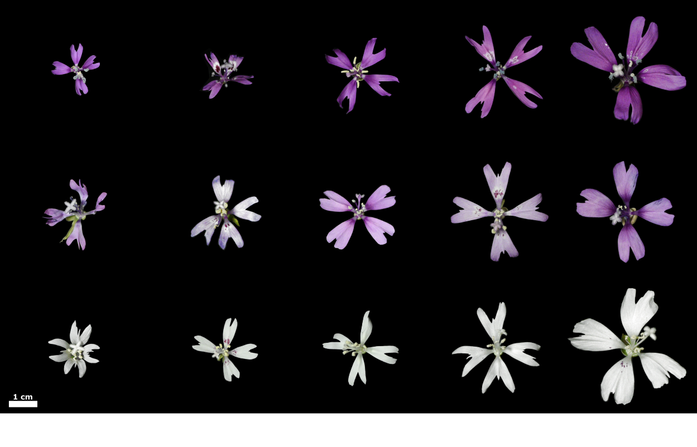

```{r setup}
#| label: load-packages
#| message: false
#| include: true
knitr::opts_chunk$set(echo = TRUE)
library(ggplot2)
library(dplyr)
library(car)
```


```{r, out.width = "400px"}
#| echo: false
#| fig-alt: "Multiple white and purple flowers of different shapes on a black background"
#| fig-cap: "A diversity of Clarkia flowers from a population of recombinanet inbred lines" 
library(knitr)

```


## Multiple regression
*Clarkia xantiana xantiana* ('xan') and *Clarkia xantiana parviflora* ('parv') are two closely-related wildflowers that can reproduce with each other. A group of researchers is interested in what factors promote gene flow between these species. They are particularly interested in mating system: Xan is mostly outcrossing, which means it mostly makes seeds using pollen from other individuals while parv is mostly selfing, meaning it uses its own pollen to make seeds. These mating system differences are related to floral differences -- parv flowers tend to have pistils that are close to the stigma so that pollen can easily move from pistil to stigma. The distance between pistil and stigma is called "herkogamy". 

A group of researchers travelled to a group of parv plants and collected data on herkogamy, distance to the nearest xan plant ('distance2hetero'), and the amount of seeds produced by this plant with ancestry from a xan pollen-parent ('admixture_proportion'). They wanted to understand how herkogamy and distance together influenced this measure of admixture proportion.

The code below loads in the data
```{r}
##load in data
clarkia_link <- "https://raw.githubusercontent.com/ybrandvain/datasets/refs/heads/master/clarkia_admix_S22P.csv"
clarkia <- read.csv(clarkia_link)

```

1. Use lm() to construct two models. 1) admixture as the response variable and herkogamy as the explanatory variable. 2) admixture_proportion as the response variable and distance2hetero as the explanatory variable. Look at the outputs of the model. Is there evidence that both explanatory variables affect the response variable?

```{r, echo=F, eval=F}
model2 <- lm(admixture_proportion~distance2hetero, data=clarkia)
model1 <- lm(admixture_proportion~herkogamy, data=clarkia)

model1
model2
Anova(model1)
Anova(model2)

#Yes, both explanatory variabes affect the response variable
```

2. It can be difficult to interpret a multiple regression model if the explanatory variables are correlated with each other (this is called 'multicollinearity'). Make a plot of herkogamy and distance2hetero and use cor.test() to estimate the relationship between these two variables. Are they correlated with each other?

```{r, echo=F, eval=F}
plot(clarkia$herkogamy, clarkia$distance2hetero, bty="n")
abline(lm(clarkia$distance2hetero~ clarkia$herkogamy))
cor.test(clarkia$herkogamy, clarkia$distance2hetero)

#Nope
```

3. Use lm() to fit a general linear model with admixture proportion as the response variable and distance2hetero and herkogamy as the explanatory variables. Use Anova() from the car package to look at the p values.

```{r, echo=F, eval=F}
model3 <- lm(admixture_proportion ~ herkogamy + distance2hetero, data=clarkia)
model3
Anova(model3)

model3i <- lm(admixture_proportion ~ herkogamy*distance2hetero, data=clarkia)
model3i
Anova(model3i)
```

4. You might be interested in whether herkogamy or distance is more important for admixture. Compare the estimates of the coefficients for these two explanatory variables -- which one appears more important based on these coefficients?

```{r echo=F, eval=F}
#herkogamy seems more important because it has a larger effect size 

```

However, herkogamy is measured on a different scale than phyiscal distance betwen plants. It might be more meaningful to compare these coefficients after standardizing them. The code below does this -- it uses a z transform to standardize the explanatory and response variables and then reruns the linear model on this standardized data.

```{r}

zTransform <- function(X){(X-mean(X,na.rm = TRUE)) / sd(X,na.rm = TRUE) } ##function to do a z transform

clarkz <- clarkia%>% mutate_all(zTransform) #make a new dataframe of z transformed data
```

5. Make some plots of the original data and the z transformed data to get a sense of what the z transformation has done.

6. Run a new linear model on the z-transformed data with admixture proportion as the response variable and herkogamy and distance2hetero as the explanatory variables. Now, compare the effect size estimates from this model. Which factor matters more for determining admixture? Have the p values changed?

```{r, eval=F, echo=F}

model4 <- lm(admixture_proportion ~ herkogamy + distance2hetero, data=clarkz)
model4
Anova(model4)

#The p values have not changed (cool). It still looks like the effect size of herkogamy is higher.

```

Petal size can also be important for attracting pollinators, and thus affect admixture. But imagine that petal size is correlated with herkogamy. The code below simulates a hypothetical petal size trait that is correlated with herkogamy.

```{r}
set.seed(101)
clarkia$petal_size = .26*clarkia$herkogamy + rnorm(nrow(clarkia), mean=0, sd=.2)+5

```

7. Construct a linear model with petal size as the explanatory variable and admixture_proportion as the response variable. Does petal size affect admixture proportion?

8. Now, make a model with admixture_proportion as the response variable and both petal_size and herkogamy as the explanatory variables. Compare the estimates and p values for petal size in the two models. Are they different or the same? Why do you think this is?

```{r, echo=F, eval=F}

plot(clarkia$herkogamy, clarkia$petal_size)
cor.test(clarkia$herkogamy, clarkia$petal_size)

model5 <- lm(admixture_proportion~petal_size, data=clarkia)
model5
Anova(model5)


model6 <- lm(admixture_proportion~petal_size + herkogamy, data=clarkia)
model6
Anova(model6)
```

## Interactions

Let's look at another Clarkia dataset that investigated on a different set of genotypes. This time, researchers were interested in whether flower color and size (measured as petal area) affected the admixture proportion.

Below is some ggplot code to download the data and make a scatter plot of the data with regression lines for each category (I like ggplot for making these types of plots). Note that the admixture proportion is now called "prop_hybrid" in this table.

```{r}
ril_link <- "https://raw.githubusercontent.com/ybrandvain/datasets/refs/heads/master/clarkia_rils.csv"
rils <- readr::read_csv(ril_link, show_col_types=F) |>
  dplyr::select(ril, prop_hybrid, petal_area_mm, asd_mm, location, petal_color) |>
  na.omit()

ggplot(rils)+
  aes(x = petal_area_mm, 
                 y = prop_hybrid, 
                 color = petal_color) +
  geom_point() +
  geom_smooth(method = "lm", se=F)+
  theme_classic()
```

9. Based on these lines, do you predict that there will be an interaction between petal color and petal area for energy expenditure? Why or why not?

10. Use lm() to fit a linear model with prop_hybrid as the response variable and with  petal color and petal area as explanatory variables. Use Anova() to look at the output -- do you see evidence of an interaction?

```{r, eval=F, echo=F}
model7 <- lm(prop_hybrid~petal_area_mm*petal_color, data=rils)
model7

Anova(model7)
```

11. Imagine that you show these results to your advisor and they tell you that you should have transformed your response variable to improve normality (since this is an assumption of a general linear model!). Look at the distribution of prop_hybrid. Does it look normal?

12. Your advisor suggests the arcsin square root transformation since your response data is a proportion. Do you agree with your advisor that you should normalize the response variable? If so, conduct the suggested transformation, generate a new model, and compare the outputs. If not, explain how you would respond to your advisor and justify your choice.


```{r, eval=F, echo=F}
clarkia$admix_t <- asin(sqrt(clarkia$admixture_proportion))
model7 <- lm(admix_t~distance2hetero + herkogamy, data=clarkia)
model7

Anova(model8)

plot(model7$fitted.values, model7$residuals)
hist(model7$residuals)
hist(model8$residuals)

# or just point out the residuals are pretty normal so you don't need to transform
```

